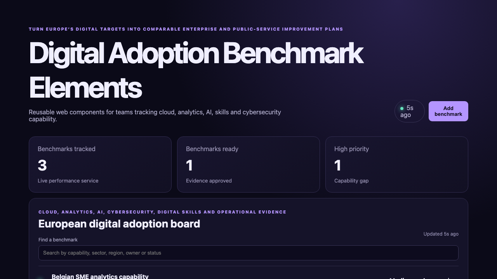

# Digital Adoption Benchmark Elements

## One-sentence benefit

Help enterprises and public services compare cloud, analytics, AI, skills and cybersecurity adoption with accountable evidence.

## Live demo

[Watch the workflow](docs/demo.webm).

## Screenshots

## Main features

- Search and sort benchmarks by capability, sector, owner or status.
- Create real benchmark records through the Java API.
- Advance evidence through draft, review and approved states.
- Show loading, empty, error and success feedback.
- Reuse encapsulated metric and workflow components responsively.

## Technology used

Lit, TypeScript, reactive controllers, custom elements, Vite, Spring Boot and Java 21.

## Installation instructions

Install Node.js 22 and Java 21. Run `npm install`, start `cd backend && mvn spring-boot:run`, then run `npm run dev`.

## Commercial licensing/contact

Commercial licensing and integration support are available through the repository contact options.

## Business problem and users

Transformation leaders, consultancies and digital agencies need comparable evidence behind technology-adoption claims.

## Key workflows

Find a benchmark, create a capability record, assign evidence ownership, advance review and confirm the API result.

## Lit/Web Components framework highlights

Lit reactive properties, keyed repeat directives, shadow DOM metric cards and a lifecycle controller create reusable elements.

## Java backend highlights

Spring Boot exposes validated list, search, create and update APIs, clear errors, health status and service tests.

## Architecture and state flow

Custom elements call `/api/items`; Java validates requests and returns records that trigger Lit rendering.

## Accessibility and responsive behaviour

Labelled controls, semantic regions, visible focus styles and responsive shadow-DOM layouts support keyboard and small screens.

## Verification commands

Run `npm test`, `npm run build`, `cd backend && mvn test` and `cd backend && mvn package`.

## Structure

`src` contains the frontend, `backend` contains Java and `docs` contains inspected media.

## Tradeoffs

In-memory records simplify local use; production needs identity, persistence and verified data-source integrations.

## Roadmap

Add sector cohorts, trend charts, evidence expiry, multilingual reports and Digital Decade data imports.
